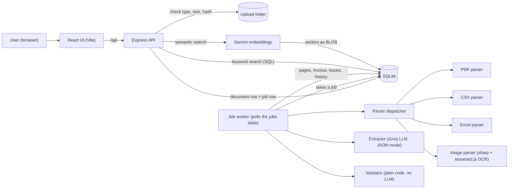

# AI-Powered Document Intelligence System

A Node.js system that accepts business documents (invoices, receipts, spreadsheets, scanned images), extracts structured invoice data with an LLM, validates it with plain code, stores everything in a database, and lets a person search, review and correct the results through a REST API and a small web UI.

Built as a technical assessment. All sample data is **synthetic**. Every number in this README that is called "measured" comes from a script in `evaluation/` and its saved report. Things that were not built or not measured are listed openly in [docs/ASSUMPTIONS_AND_LIMITATIONS.md](docs/ASSUMPTIONS_AND_LIMITATIONS.md).

## What it does

| Area | Supported |
|---|---|
| Input | PDF (digital text), JPG, PNG (OCR), XLSX (multi-sheet), CSV |
| Not supported | Scanned PDFs, TIFF, old `.xls`, password-protected PDFs |
| Extraction | Invoice number, date, supplier, customer, subtotal, tax, total, currency, line items. A value that is not in the document stays `null`. |
| Validation | Missing fields, bad numbers, bad dates, total / line-item mismatch, duplicate files, duplicate invoices, cross-document mismatch. Documents with an error are flagged for manual review. |
| API | Upload, status, result, list and filter, keyword and semantic search, manual correction, reprocess of failed documents |
| Background work | Uploads return at once (HTTP 202). A worker processes jobs from a queue stored in SQLite, with retries and crash recovery. |
| UI | Multi-file upload, status per file, results with errors and warnings, correction form, keyword and semantic search |

## Architecture



Flow of one upload:

1. `POST /api/documents` checks each file (extension, magic bytes, size), computes a SHA-256 hash, saves the file under a random name, and writes a `documents` row and a `jobs` row. The answer is `202`.
2. The worker picks the job, parses the file into pages (a page is a PDF page, an Excel sheet, or one OCR image) and stores the text.
3. If the same file hash was already processed, the earlier result is reused and the LLM is not called.
4. Otherwise the text (first 12,000 characters) is sent to the LLM, which returns JSON in a fixed schema.
5. The validator checks the result and writes issues. Any `error` issue sets `needs_review`.
6. The UI polls the list while something is queued or processing.

The same flow in n8n terms, for readers who know n8n: Webhook = upload API, Extract From File = parsers, LLM node = extractor, IF/Code = validator, Supabase = SQLite, a second workflow with Schedule Trigger = the worker.

## Tech stack

- Backend: Node.js, Express 5, SQLite (`better-sqlite3`), `multer`, `helmet`, `express-rate-limit`, `winston`
- Parsing: `pdf-parse`, `csv-parse`, `exceljs`, `sharp`, `tesseract.js`
- AI: Groq chat completions (model set in `.env`, `openai/gpt-oss-20b` was used for all measurements), Gemini `gemini-embedding-001` for semantic search
- Frontend: React 19, Vite
- Tests: `node:test`

Developed and tested on Windows 11 with Node v24.22.0.

## Setup

### 1. Backend

```
cd backend
npm install
```

Create the settings file and fill in your own keys. Never commit `.env` (it is in `.gitignore`).

```
# Windows PowerShell
Copy-Item .env.example .env
# macOS / Linux
cp .env.example .env
```

Open `backend/.env` and set at least:

- `GROQ_API_KEY`: your Groq key
- `GROQ_MODEL`: the model name, for example `openai/gpt-oss-20b`
- Optional, for semantic search: `GEMINI_API_KEY` and `GEMINI_EMBEDDING_MODEL=gemini-embedding-001` (bare name, without a `models/` prefix)

Start the server from the `backend` folder:

```
npm start
```

The API listens on `http://localhost:3000`. Without a Groq key uploads are accepted but extraction fails with a clear message. Without a Gemini key, semantic search answers `503` and keyword search still works.

The first image (OCR) job downloads the English language data (`eng.traineddata`, about 5 MB) from a CDN into `backend/data/tessdata`. Internet access is needed once. On an offline server, place the file there beforehand.

### 2. Frontend

In a second terminal:

```
cd frontend
npm install
npm run dev
```

Open `http://localhost:5173`. The Vite dev server forwards `/api` to `http://localhost:3000`, so the browser needs no CORS setup. `npm run build` creates `frontend/dist`. The backend does not serve that folder, so host it with any static web server and point `/api` to the backend.

### 3. Settings (`backend/.env`)

| Name | Default | Meaning |
|---|---|---|
| `PORT` | 3000 | API port |
| `CORS_ORIGIN` | `http://localhost:5173` | Browser origin allowed to call the API |
| `DB_PATH` | `./data/app.sqlite` | SQLite file |
| `UPLOAD_DIR` | `./uploads` | Where uploaded files are stored |
| `MAX_FILE_SIZE_MB` | 50 | Largest accepted file |
| `MAX_FILES_PER_UPLOAD` | 10 | Files per request |
| `MAX_PDF_PAGES` | 1500 | PDFs with more pages are rejected before text extraction |
| `WORKER_CONCURRENCY` | 2 | Jobs processed at the same time |
| `WORKER_POLL_MS` | 1500 | How often the worker looks for jobs |
| `JOB_MAX_ATTEMPTS` | 3 | Tries for a temporarily failing job |
| `GROQ_API_KEY`, `GROQ_MODEL` | none | LLM access |
| `GEMINI_API_KEY`, `GEMINI_EMBEDDING_MODEL` | none | Semantic search |
| `LOG_LEVEL` | info | Log detail |

## REST API

Errors are JSON: `{ "error": "message" }`. Timestamps are stored in UTC.

| Method and path | Purpose |
|---|---|
| `POST /api/documents` | Upload up to 10 files in the multipart field `files`. Returns `202` if at least one file was accepted. Rejected files are reported with a reason. `400` if all were rejected, `413` if a file is too large. |
| `GET /api/documents` | List documents. Filters: `q`, `status`, `supplier`, `from`, `to`, `needs_review`, `limit` (default 20, max 100), `offset`. |
| `GET /api/documents/:id` | Status and metadata of one document |
| `GET /api/documents/:id/result` | Document, extracted invoice with line items, validation issues, correction history |
| `POST /api/documents/:id/reprocess` | Run a failed document again. `409` if it did not fail. |
| `PATCH /api/invoices/:id` | Manual correction of fields. Every change is audited and the invoice is validated again. |
| `GET /api/search?q=&mode=keyword\|semantic` | Keyword search (text of pages and invoice fields, with page numbers and snippets) or semantic search (ranked by similarity score) |
| `GET /api/health` | Health check |

Example:

```
curl.exe -F "files=@invoice.csv" http://localhost:3000/api/documents
curl.exe http://localhost:3000/api/documents/1/result
```

## Validation rules

Validation is ordinary code, not an LLM, so the same input always gives the same checks.

`missing_field`, `invalid_number`, `negative_amount`, `invalid_date`, `invalid_currency`, `total_mismatch` (subtotal + tax vs total, tolerance 0.01), `missing_line_items`, `line_item_math`, `line_items_mismatch`, `duplicate_invoice`, `cross_document_mismatch` (same supplier and number, different total), `duplicate_file` (same SHA-256), `text_truncated`, `low_text_pages`, plus `uncertain_value` warnings for values the model doubts or that are not found in the source text.

## Tests

```
cd backend
npm test
```

149 tests with `node:test`, all passing in the last run (about 7 seconds). They cover file-type checks, parsers (PDF, CSV, Excel, image), extraction, validation, the pipeline, the worker and retries, the REST API, correction, search, semantic search and failure cases. The LLM, the embedding service and OCR are replaced by fakes in tests, so tests need no network and no keys. Real LLM calls happen only in the evaluation scripts below.

## Evaluation (measured, synthetic data)

Details: [evaluation/REPORT.md](evaluation/REPORT.md), [evaluation/SEMANTIC_REPORT.md](evaluation/SEMANTIC_REPORT.md), raw data in `results.json` files.

**Extraction and validation.** One real run on 2026-11-05, 27 labeled synthetic files (10 PDF, 5 CSV, 6 XLSX, 3 images, 2 corrupt files, 1 rejected file), model `openai/gpt-oss-20b`, prompt v1.

| Measure | Result |
|---|---|
| Field accuracy (8 fields) | 184 of 192 = 95.8% |
| Documents with all 8 fields correct | 23 of 24 |
| Line-item count correct | 23 of 24 |
| Invented values | 0 |
| Jobs that reached `completed` | 24 of 24 (this means the job finished, not that the data is right) |
| Corrupt or fake files handled correctly | 3 of 3 |
| Average job time | 6.2 s (median 4.6 s, max 22.9 s) |

By file type: PDF 80/80, CSV 40/40, XLSX 48/48, images 16/24 fields (66.7%). All 8 wrong fields came from one very poor image (rotated, blurred, low JPEG quality) where OCR read no text. The system left every field empty and flagged the document for review. It did not invent values. Review flags: 7 correctly raised, 16 correctly not raised, 1 false alarm (that same image), 0 missed. All 7 expected validation rules were found.

Time per file type must not be read as a property of the type: 22 files were sent together and the LLM provider has a tokens-per-minute limit, so waiting is mixed into the times.

**Semantic search.** 21 synthetic invoices, 19 queries written by the developer (not a blind test), one run. Correct invoice at rank 1 for 13 of 17 queries, in the top 3 for 15 of 17, mean reciprocal rank 0.823. No similarity cutoff is used because scores of correct and other invoices overlap (correct 0.561 to 0.754, others 0.518 to 0.726). Exact names and numbers can rank low in semantic mode, so use keyword mode for those.

**Reproduce.** The scripts use real LLM calls and their own temporary database and port. Run from the repository root with the backend `.env` filled in:

```
node evaluation/runEvaluation.js
node evaluation/runSemanticEval.js
```

## Security

An automated self-check (`node evaluation/runSecurityCheck.js`) starts its own backend copy and runs 62 checks. Last run: **49 PASS, 0 FAIL, 13 INFO** (observations). Report: [evaluation/SECURITY_REPORT.md](evaluation/SECURITY_REPORT.md). It is a self-check, not a penetration test or certificate.

In place:

- File type is checked by extension **and** first bytes; size and file-count limits; random file names on disk; sanitized display names; rejected files are removed from disk
- `helmet` headers, restricted CORS, no `X-Powered-By`
- Rate limits: 300 requests per minute per IP on `/api`, 30 uploads per minute per IP (counters are in memory, per process)
- All SQL uses bound parameters; correction input is validated (allowed keys, types, lengths, real dates)
- Document text goes to the LLM only as data inside delimiters; the output must match a fixed schema
- Error responses hide internal details; the UI shows all values as plain text (React escaping). A person typing `<b>test</b>` as a supplier name sees exactly that text.
- API keys only in `.env` (git-ignored)

Not in place (see the report): no login or authentication, zip-bomb handling is untested, no antivirus scan, HTTPS must come from a reverse proxy.

## Performance and scalability

Parsing only (no LLM), measured once on synthetic PDFs made by code (15 short text lines per page): a 1000-page PDF (1.2 MB) was parsed in 900 ms (about 1111 pages per second), all 1000 pages returned the expected text, and the peak memory of the Node process was 170.8 MB (this number includes earlier runs in the same process). A 1501-page PDF was rejected in 32 ms with `PAGE_LIMIT` (limit 1500). Real PDFs with images or complex layout can be slower. Sending a 1000-page document through AI extraction is not built. Details: [evaluation/PDF_BENCHMARK.md](evaluation/PDF_BENCHMARK.md).

Design for growth: PDFs are read in chunks of 50 pages; the job queue allows several workers; there is a page limit. For production the README-level upgrade path is PostgreSQL (with pgvector for semantic search) instead of SQLite, and BullMQ with Redis instead of the SQLite job table. These are **not built**.

## Project structure

```
backend/      Express API, worker, parsers, validator, SQLite schema, tests
frontend/     React UI (Vite)
evaluation/   Labeled dataset, evaluation and security scripts, measured reports
docs/         Database schema, assumptions and limitations
AI_Prompts    AI-use disclosure (submitted as AI_Prompts.docx)
```

## Assumptions and limitations

Read [docs/ASSUMPTIONS_AND_LIMITATIONS.md](docs/ASSUMPTIONS_AND_LIMITATIONS.md). The most important points:

- One document is treated as one invoice.
- "Cross verification" is implemented as comparing the same invoice (supplier and number) across two documents. Purchase-order matching is not done.
- Scanned PDFs and TIFF are not supported. OCR works for JPG and PNG, English only.
- Only the first 12,000 characters of a document go to the LLM.
- All evaluation data is synthetic.

## Database

See [docs/DATABASE.md](docs/DATABASE.md).

## AI use disclosure

- At runtime: Groq (LLM extraction) and Gemini (embeddings) receive document text.
- During development: an AI assistant helped plan, write and review code and tests. Every prompt is documented in `AI_Prompts.docx`, submitted with the assessment. The developer ran, tested and committed all code, and the measured results come from real runs of the scripts above.