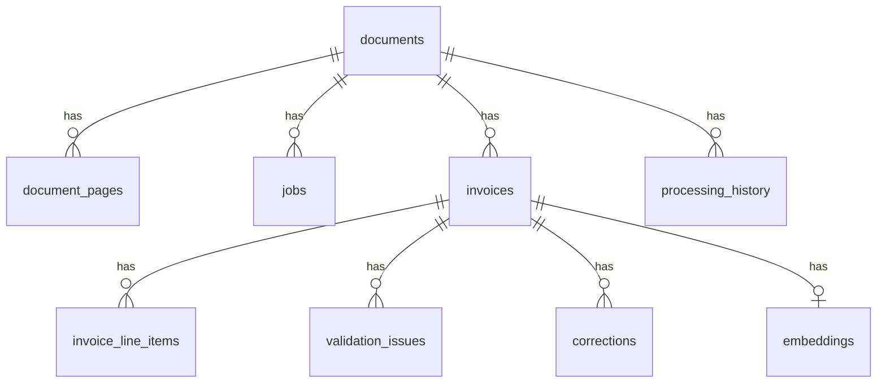

# Database

SQLite (via `better-sqlite3`), created automatically from `backend/src/db/schema.sql` when the server starts. Timestamps are text in UTC (`datetime('now')`). Money values are `REAL`; the validator compares them with a tolerance of 0.01. Foreign keys cascade on delete.

For production, PostgreSQL is the intended database (money as `NUMERIC`, vectors with `pgvector`). That change is **not built**.

## Relations

## Tables

### documents
One row per uploaded file (metadata).

| Column | Meaning |
|---|---|
| `id` | Primary key |
| `original_name` | Sanitized display name |
| `stored_name` | Random name on disk (never shown through the API) |
| `mime_type`, `detected_type` | Type sent by the client, and the type found from the first bytes (`pdf`, `jpeg`, `png`, `tiff`, `xlsx`, `xls`, `csv`) |
| `size_bytes`, `sha256` | Size and file hash (used for duplicate-file detection) |
| `page_count` | Pages, sheets, or 1 for an image |
| `status` | `queued`, `processing`, `completed`, `failed` |
| `needs_review` | 1 if any validation issue has severity `error` |
| `error_message` | Short reason when `failed` |
| `created_at`, `updated_at` | UTC timestamps |

Indexes: `status`, `sha256`, `needs_review`.

### document_pages
Extracted text, one row per PDF page, Excel sheet, or OCR image.

| Column | Meaning |
|---|---|
| `document_id` | Owner document |
| `page_number`, `sheet_name` | Position (PDF page number, or sheet name for Excel) |
| `text` | Extracted text (used by keyword search) |
| `ocr_used`, `ocr_confidence` | Set for image pages |

### jobs
The background queue.

| Column | Meaning |
|---|---|
| `document_id`, `type` | What to process (`process`) |
| `status` | `queued`, `processing`, `done`, `failed` |
| `attempts`, `max_attempts` | Retry counter and limit (default 3) |
| `last_error` | Last error text |
| `locked_at` | When a worker took the job. A job stuck in `processing` is put back to `queued` after a restart. |
| `created_at`, `finished_at` | Timestamps |

### invoices
The structured result. Today one document gives one invoice (`segment_index` 0); the column exists so several invoices per document can be added later.

| Column | Meaning |
|---|---|
| `document_id`, `segment_index` | Unique pair |
| `page_start`, `page_end` | Reserved for multi-invoice documents |
| `invoice_number`, `invoice_date`, `supplier_name`, `customer_name` | Text fields (`invoice_date` is `YYYY-MM-DD`) |
| `subtotal`, `tax`, `total`, `currency` | Amounts and 3-letter currency code |
| `confidence_json`, `uncertain_fields_json` | Model confidence per field (not reliable) and fields marked uncertain |
| `raw_llm_json` | The model answer as received |
| `model`, `prompt_version` | Which model and prompt version produced it |
| `is_corrected` | 1 after a manual correction |

Indexes: `document_id`, and `(supplier_name, invoice_number)` for duplicate checks.

### invoice_line_items
`description`, `quantity`, `unit_price`, `amount` for each line of an invoice.

### validation_issues

| Column | Meaning |
|---|---|
| `invoice_id` | Invoice checked |
| `rule` | Rule name, for example `total_mismatch` |
| `severity` | `error` or `warning` |
| `field` | Field concerned (or `document`) |
| `message` | Human-readable explanation |

### processing_history
Audit of status changes per document: `event`, `from_status`, `to_status`, `detail`, `duration_ms`, `created_at`.

### corrections
Audit of manual changes: `invoice_id`, `field`, `old_value`, `new_value`, `created_at`.

### embeddings
Vectors for semantic search: `invoice_id` (primary key), `model`, `vector` (Float32 values stored as a BLOB), `text_hash` (the vector is made again when the invoice text changes), `created_at`. Search compares the question vector with all stored vectors in memory (cosine similarity), which is fine for small data and grows linearly with the number of invoices.